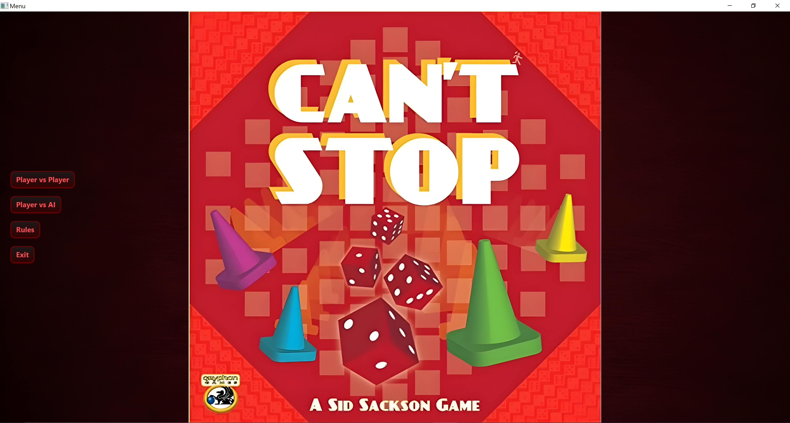
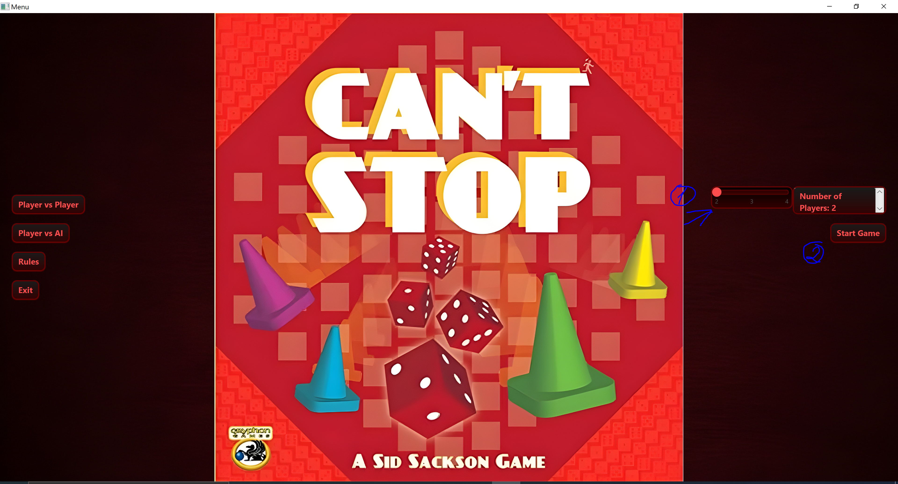
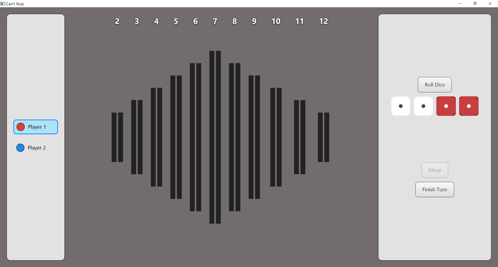

## How to play

1) Press Player vs Player to start a new game.

3) Pick number of players (2-4) and start the game.

4) Press “Roll Dice” to roll four dice.
5) Pick a sum. The UI shows the complementary sum automatically (because two sums make one pairing).
6) Press “Move” to apply the pairing.
7) Repeat roll → move until you decide to stop or you bust.
8) Press “Finish Turn” to commit your progress.

Notes:
- Temporary progress is gray; committed progress uses the player’s color.